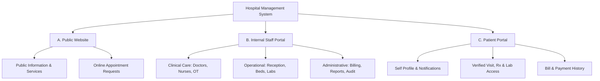

# 01. Project Requirements Specification
**Meghna Clinic and Nursing Home — Hospital Management System (HMS)**

---

## 1. Project Information
- **Project Name:** Hospital Management System (HMS)
- **Organization:** Meghna Clinic and Nursing Home
- **Location:** Shohid Minar Mor, Dinajpur, Bangladesh
- **Framework:** Laravel 12 (Monolithic Architecture)
- **Backend:** PHP 8.2+
- **Frontend:** HTML5, CSS3, JavaScript, Bootstrap 5, Laravel Blade
- **Database:** MySQL (Relational InnoDB)
- **Local Environment:** XAMPP (Localhost development)
- **Version Control:** Git & GitHub (`hospital-management-system` branch)

---

## 2. Organization Baseline Profile
- **Total Inpatient Bed Capacity:** 10 beds (General and Department-wise, fully configurable)
- **Staff Strength:** Approximately 14 staff members
- **Medical Officers / Doctors:** 2 doctors available at all times (including 1 dedicated Emergency Doctor)
- **Nursing Staff:** 6 nurses/sisters operating in 8-hour shift rotations
- **Core Clinical Departments:**
  1. Gynecology
  2. Orthopedic
  3. Surgery
- **Clinical & Administrative Support Units:**
  1. Emergency Unit
  2. Reception / Front Desk
  3. Billing & Accounts
  4. Operation Theatre (OT) & Ward Boys
  5. Cleaners / Housekeeping

> [!NOTE]
> The above staff counts and bed numbers represent the clinic's initial operational profile. All staff rosters, department assignments, and bed allocations must remain dynamic and configurable through system settings.

---

## 3. High-Level System Scope

The system comprises three integrated components operating over a unified database:

### Component A: Public Website
Designed for prospective and regular patients, visitors, and community members:
1. **Home:** Clinic overview, emergency hotline, key highlights.
2. **About Clinic:** History, mission, facility profile, location at Dinajpur.
3. **Departments:** Gynecology, Orthopedic, Surgery, Emergency details.
4. **Doctors:** Doctor profiles, specialties, visiting hours.
5. **Services:** Diagnostic, surgical, maternal, and emergency services.
6. **Appointment Request:** Public request form (patient details, preferred date, department/doctor).
7. **Contact & Location:** Contact numbers, Google map / address guide at Shohid Minar Mor.

### Component B: Internal Hospital Management Portal
Role-protected portal for hospital operations, clinical documentation, and governance:
1. **Admin Dashboard:** Real-time occupancy, revenue summary, patient count, doctor status.
2. **User & Staff Management:** User credentials, staff profiles, shift assignments.
3. **Department Management:** Department configuration, assigned beds and doctors.
4. **Patient Management:** Search, master patient registration, duplicate check.
5. **Appointment Management:** Reviewing, scheduling, and approving public & offline appointment requests.
6. **Doctor Consultation:** Clinical notes, triage, diagnosis, and prescription authoring.
7. **Nursing Management:** Vital signs recording, nursing observation notes, medication administration records (MAR).
8. **Admission & Bed Management:** Inpatient admission, bed allocation, bed transfer, maintenance status.
9. **Laboratory Management:** Internal test processing, external lab partner order management, report upload, and doctor review.
10. **Operation Management:** OT scheduling, operation notes, surgeon and team assignment, post-op notes.
11. **Billing & Payment Management:** Auto-calculated service, bed, and test charges; partial payments; due tracking; receipts.
12. **Discharge Management:** Dual-step clinical & financial clearance, discharge summary, bed release.
13. **Reports & Audit Logs:** Revenue reports, bed occupancy reports, patient statistics, audit trail.

### Component C: Patient Portal
Secure personal health portal for patients:
1. **Patient Registration & Login:** Self-registration and secure authentication.
2. **Personal Profile:** Personal information and emergency contact management.
3. **Appointment Tracking:** Submit appointment requests and view real-time status.
4. **Visit & Consultation History:** Timeline of all clinic visits and attending doctors.
5. **Authorized Prescription Access:** View and download verified doctor prescriptions.
6. **Authorized Laboratory Reports:** View and download verified diagnostic test reports.
7. **Billing & Payments:** View invoices, payment receipts, and outstanding dues.
8. **Notifications:** System alerts for appointment approval, report availability, and follow-ups.

> [!IMPORTANT]
> **Patient Account Linking Rule:** Patient self-registration must **never** automatically grant access to existing clinical records. Access to past medical records requires staff verification (manual identity confirmation or verified phone/ID linking) to protect sensitive medical data.

---

## 4. User Roles (9 Approved Roles)
1. **Super Admin:** Complete system oversight, audit log review, database backup, system configuration.
2. **Administrator:** Staff management, department/bed settings, overall operational supervision.
3. **Receptionist:** Patient registration, appointment intake, visit creation, bed inquiry.
4. **Doctor:** Consultations, diagnosis, prescriptions, lab test orders, OT decisions, clinical clearance.
5. **Nurse/Sister:** Vital signs recording, bedside nursing notes, medication administration, bed status updates.
6. **Lab Staff:** Internal sample processing, external partner coordination, test report upload.
7. **Billing Staff:** Invoice generation, payment collection, partial payments, financial clearance.
8. **OT/Ward Staff:** Operation preparation, bed sanitation/cleaning status updates, patient transport.
9. **Patient:** Viewing personal appointments, authorized prescriptions, verified reports, and bills.

---

## 5. Explicit Scope Boundaries (Pharmacy Policy)
- **Out of Scope (Deferred to Future Phase):**
  - Pharmacy medicine inventory & stock management
  - Medicine purchase orders & vendor/supplier management
  - Batch tracking & expiry date monitoring
  - Retail pharmacy point-of-sale (POS) and counter sales
- **In Scope (Current Phase):**
  - Doctor's prescription generation (medication names, dosage, duration, instructions)
  - Nursing Medication Administration Records (MAR) tracking dosage given to inpatients
  - Extensible relational schema designed for future pharmacy plug-in

---

## 6. Unresolved / Configurable Parameters (Awaiting Project Owner Direction)

| Parameter | Current Status | Proposed Default Option |
| :--- | :--- | :--- |
| **Patient ID Format** | Unresolved | `MCNH-YYYY-XXXX` (e.g. `MCNH-2026-0001`) |
| **Visit Number Format** | Unresolved | `VIS-YYYYMMDD-XXX` (e.g. `VIS-20261031-001`) |
| **Admission Number Format** | Unresolved | `ADM-YYYYMMDD-XXX` (e.g. `ADM-20261031-001`) |
| **10 Bed Naming Scheme** | Unresolved | Configurable (`EM-01`, `EM-02`, `GYN-01`, `GYN-02`, `SUR-01`, `SUR-02`, `GEN-01` to `GEN-04`) |
| **Bed Billing Calculation** | Unresolved | 24-hour cycle vs Calendar Day midnight cut-off |
| **Admission Base Fee** | Unresolved | Fixed admission fee vs Variable based on ward category |
