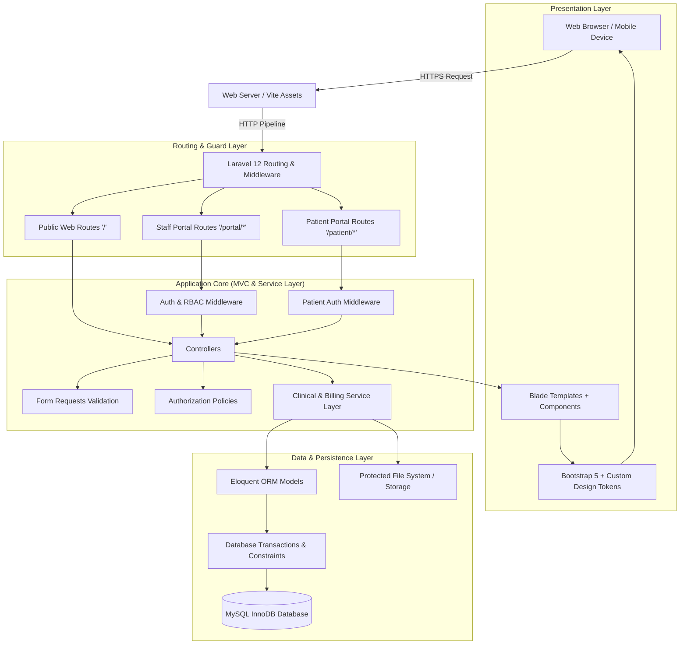

# 02. System Architecture & Design System Specification
**Meghna Clinic and Nursing Home — Hospital Management System (HMS)**

---

## 1. Architectural Philosophy: Laravel Monolith
The system is built as a unified, high-reliability **Laravel 12 Monolith**.
- Avoids fragile network synchronization and SPA hydration overhead.
- Maximizes data consistency via MySQL InnoDB ACID transactions.
- Provides native server-side rendered security for clinical records.
- Organizes code cleanly into domain-specific Controllers, Services, Form Requests, and Policies.



---

## 2. Logical Portal Separation

The application enforces a clear division between three user contexts:

```
Hospital_Management_System/
├── app/
│   ├── Http/
│   │   ├── Controllers/
│   │   │   ├── Public/         # Home, About, Doctors, Appointment Request
│   │   │   ├── Staff/          # Admin, Reception, Doctor, Nurse, Lab, Billing, OT
│   │   │   └── Patient/        # Patient Dashboard, Profile, Records, Invoices
│   │   ├── Middleware/         # RoleCheck, EnsurePatientLinked, ActiveStaff
│   │   └── Requests/           # Strict validation per action
│   ├── Models/                 # Domain Entities (Patient, Visit, Bed, Bill, etc.)
│   ├── Services/               # Business Logic (AdmissionService, BillingService, LabService)
│   └── Policies/               # Granular Model Permissions (PatientPolicy, BedPolicy, etc.)
└── resources/
    └── views/
        ├── layouts/
        │   ├── public.blade.php    # Clean marketing and public portal layout
        │   ├── staff.blade.php     # Enterprise Bento Grid SaaS dashboard layout
        │   └── patient.blade.php   # Patient-friendly, mobile-first dashboard layout
        ├── public/
        ├── staff/
        └── patient/
```

---

## 3. Brand Design System & Visual Guidelines

The user interface follows a modern, accessible, enterprise healthcare visual design system:

### A. Approved Brand Color Palette

| Token Name | Hex Code | Purpose & Usage |
| :--- | :--- | :--- |
| **Primary Navy** | `#123B5D` | Main navigation headers, primary brand identity, active tabs, core branding |
| **Medical Teal** | `#087F8C` | Action buttons, accents, callouts, success highlights, icons |
| **Soft Background** | `#F4F7FA` | Page body background, clean readable contrast, card backgrounds |
| **Dark Text** | `#263445` | High-contrast typography, heading elements, data tables |
| **Border Gray** | `#E2E8F0` | Subtle Bento card borders, dividers, form input borders |

### B. Standard Status Colors

| State | Hex / Class | Clinical & Operational Meaning |
| :--- | :--- | :--- |
| **Success** | `#10B981` (Green) | Available Bed, Paid Invoice, Reviewed Lab Report, Discharged |
| **Warning** | `#F59E0B` (Amber) | Reserved Bed, Partial Payment, Pending Appointment Request |
| **Danger** | `#EF4444` (Red) | Occupied Bed, Unpaid Bill, Emergency Triage, Critical Condition |
| **Information**| `#3B82F6` (Blue) | Bed under Cleaning/Maintenance, In-Progress Lab Test, Regular Visit |

### C. Typography Standards
- **English Typography:** **Inter** (`font-family: 'Inter', sans-serif;`) — Clean, high legibility for tabular medical and numerical data.
- **Bengali Typography:** **Hind Siliguri** (`font-family: 'Hind Siliguri', sans-serif;`) — Native, smooth rendering for bilingual clinical receipts and public website text.

### D. UI/UX Principles
1. **Minimalism & Bento Grid:** Dashboard interfaces utilize modular, card-based Bento grids displaying critical clinical stats (bed status, OPD queue, emergency cases) without visual clutter.
2. **Accessible & Mobile-First:** High-contrast text compliance (WCAG AA), accessible form fields with explicit labels, and fully responsive layouts optimized for mobile devices and ward tablets.
3. **Restraint in Motion:** Zero distracting or excessive animations; micro-interactions are reserved strictly for button states, loading spinners, and modal dialogs.
4. **Data Density & Readability:** Dense yet scannable data tables for patient histories, vitals charts, and financial ledgers with fixed headers and responsive wrappers.
