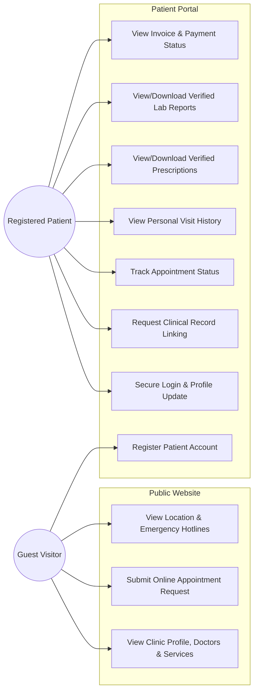
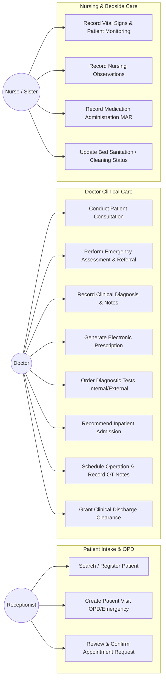
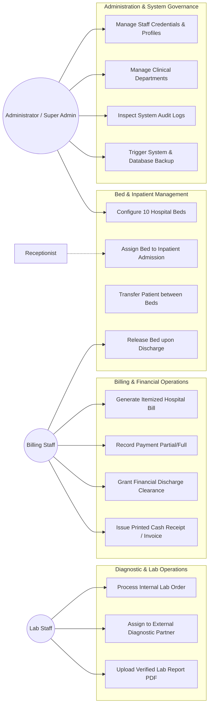

# 03. Use Case Specifications & Diagrams
**Meghna Clinic and Nursing Home — Hospital Management System (HMS)**

---

## 1. System Actors & Primary Responsibilities

| Actor | Category | Primary Operational Scope |
| :--- | :--- | :--- |
| **Guest / Visitor** | External | Browsing public hospital services, doctors, and submitting online appointment requests |
| **Patient** | External | Accessing personal verified medical visits, prescriptions, lab reports, and billing |
| **Receptionist** | Internal Staff | Patient registration, visit intake, offline/online appointment scheduling, bed inquiries |
| **Doctor** | Clinical Staff | Clinical consultations, triage, diagnoses, prescriptions, lab orders, OT scheduling, discharge clearance |
| **Nurse / Sister** | Clinical Staff | Bedside vital recording, nursing observation notes, medication administration (MAR), bed readiness |
| **Lab Staff** | Diagnostic Staff | Internal test processing, external lab partner order management, report upload |
| **Billing Staff** | Administrative | Bill itemization, payment receipts, partial payment handling, financial clearance |
| **OT / Ward Staff** | Operational | Operation theater preparation, bed sanitation/cleaning, patient transportation |
| **Administrator** | Governance | Staff roster management, department/bed settings, overall operational supervision |
| **Super Admin** | Governance | Complete system configuration, role/permission management, audit trail inspection, database backup |

---

## 2. Public Website & Patient Portal Use Cases

---

## 3. Clinical & Inpatient Operations Use Cases

---

## 4. Diagnostics, Bed Management, Billing & Administration Use Cases

