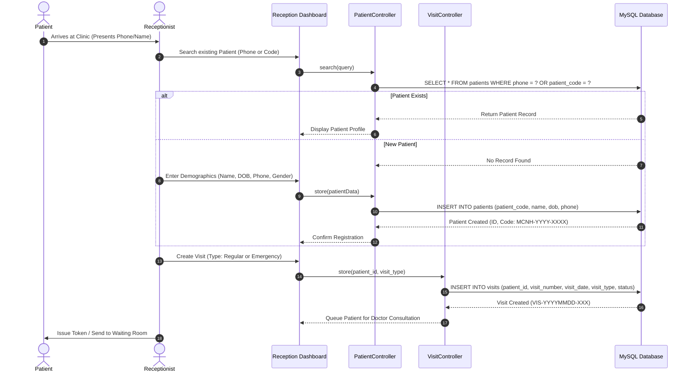
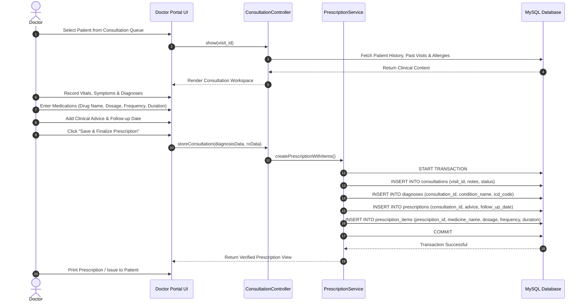
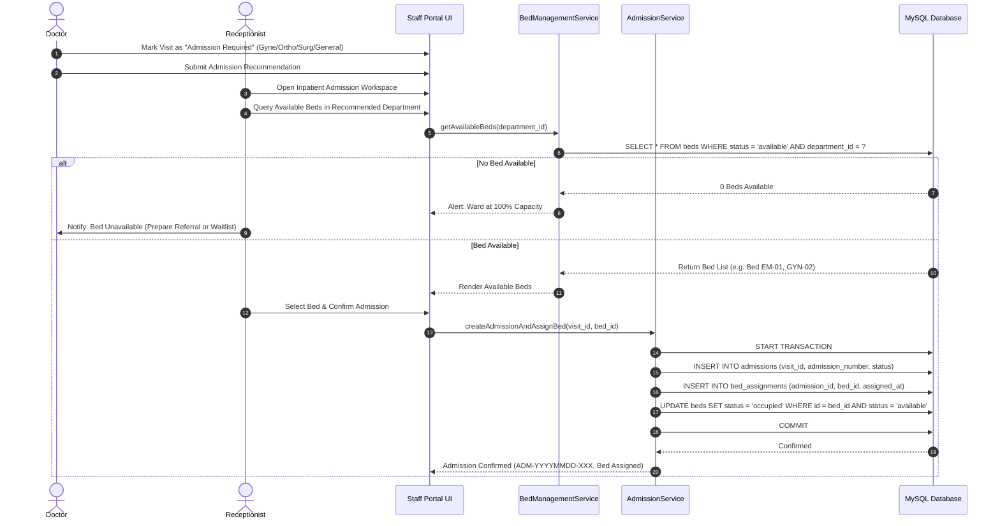
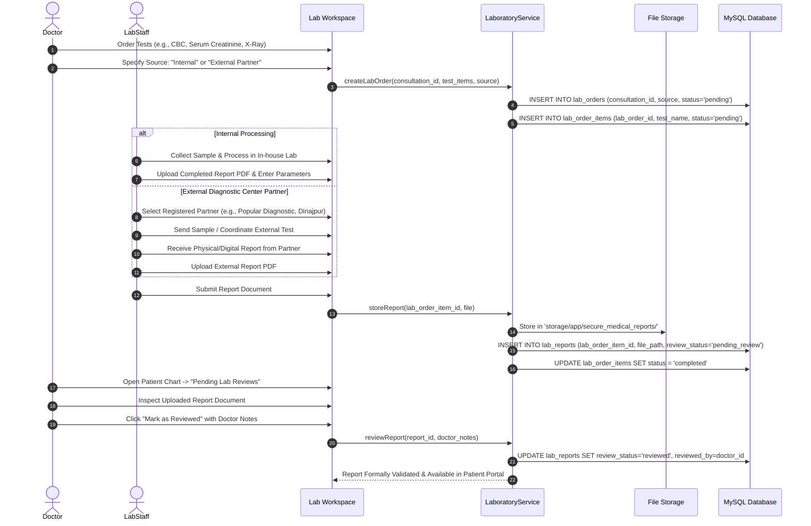
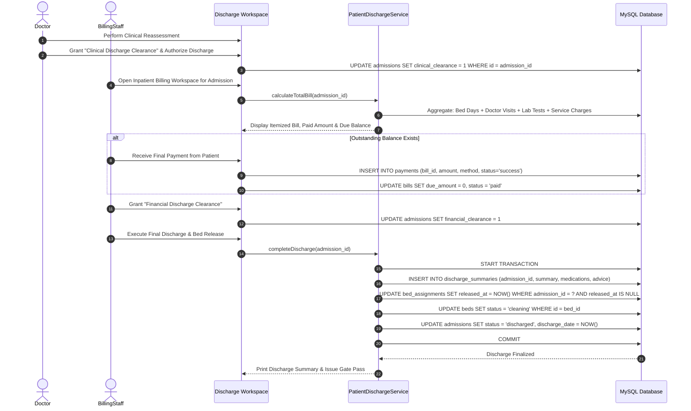

# 04. System Sequence Diagrams
**Meghna Clinic and Nursing Home — Hospital Management System (HMS)**

---

## 1. Sequence 1: Patient Registration & Visit Intake (Reception)

---

## 2. Sequence 2: Doctor Consultation, Diagnosis & Prescription

---

## 3. Sequence 3: Inpatient Admission & Bed Allocation

---

## 4. Sequence 4: Internal & External Laboratory Workflow

---

## 5. Sequence 5: Dual Clearance, Billing & Discharge

