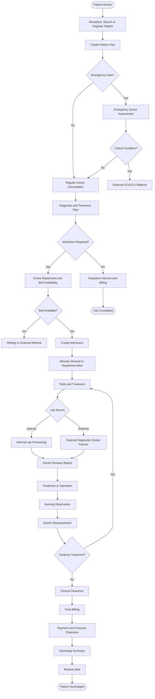

# 08. Approved Clinical & Operational Business Workflows
**Meghna Clinic and Nursing Home — Hospital Management System (HMS)**

---

## 1. Master Clinical & Patient Lifecycle Flowchart

---

## 2. Granular Workflow Stages

### Stage 1: Patient Intake & Emergency Triage
1. **Reception Check:**
   - Patient arrives at Shohid Minar Mor clinic.
   - Receptionist searches by mobile number or Patient ID. If unrecorded, demographic profile is captured and a unique Patient ID (`MCNH-YYYY-XXXX`) is issued.
2. **Visit Creation:**
   - A new visit (`VIS-YYYYMMDD-XXX`) is registered.
   - **Triage Decision:** If the patient presents with trauma, acute respiratory distress, or severe hemorrhage, the visit is flagged as **Emergency Case** and instantly queued to the on-duty Emergency Doctor.
3. **Emergency Escalation (ICU / CCU Protocol):**
   - Meghna Clinic operates a 10-bed secondary care setup without an internal ICU/CCU.
   - If the Emergency Doctor determines that the condition is hemodynamically unstable or requires life-support/intensive monitoring:
     - The visit is marked as **External ICU/CCU Referral**.
     - An external referral summary is issued immediately.
     - The patient is stabilized and transferred to an external tertiary facility (e.g., M. Abdur Rahim Medical College Hospital, Dinajpur).

---

### Stage 2: Outpatient (OPD) Consultation & Billing
1. If emergency is ruled out or patient arrives for standard appointment:
   - Patient is routed to the attending Medical Officer (Gynecology, Orthopedic, or General Surgery).
2. Doctor evaluates chief complaints, performs physical examination, records provisional diagnoses, and author electronic prescriptions.
3. **Admission Evaluation:**
   - **No Admission Needed:** Patient proceeds to Outpatient Cashier, pays consultation/service charges, collects printed prescription, and the visit is marked **Visit Completed**.
   - **Admission Recommended:** Patient proceeds to the Inpatient Admission Desk.

---

### Stage 3: Inpatient Admission & 10-Bed Allocation
1. **Bed Availability Verification:**
   - Reception queries bed occupancy for the requested department (Gynecology, Orthopedic, Surgery, Emergency, or General Ward).
2. **Capacity Handling:**
   - **Beds Full (10/10 Occupied):** The system prevents over-allocation. The receptionist flags the patient as **Waiting** or coordinates external transfer.
   - **Bed Available:** An admission record (`ADM-YYYYMMDD-XXX`) is created.
3. **Allocation Lock:**
   - The specific bed (e.g., `EM-01`, `GYN-02`) is assigned.
   - A `bed_assignments` record is opened (`assigned_at = NOW()`).
   - The bed status transitions from `available` $\rightarrow$ `occupied` atomically within a database transaction.

---

### Stage 4: Diagnostic Tests (Internal vs External Partners)
1. Attending doctor orders required clinical investigations.
2. **Routing by Test Source:**
   - **Internal Lab:** Routine hematology, urine routine, glucose tests are routed to the clinic's internal lab. In-house lab staff collect samples, process tests, and upload digital report files.
   - **External Diagnostic Partner:** Specialized imaging (MRI/CT), advanced histopathology, or hormone assays are assigned to an authorized external partner (e.g., local diagnostic centers in Dinajpur). Lab staff record partner dispatch and upload the partner's verified report upon receipt.
3. **Mandatory Doctor Review:**
   - Uploaded reports remain in `pending_review` state.
   - The ordering doctor must inspect the findings and click **"Mark as Reviewed"** with clinical notes before the report is unlocked for discharge clearance or patient portal viewing.

---

### Stage 5: Inpatient Clinical Loop & Nursing Observations
1. **Surgical / Medical Procedures:** Operative procedures are scheduled in the Operation Theatre (OT), and operative notes are recorded.
2. **Nursing Observations & MAR:**
   - Shift nurses record temperature, blood pressure, pulse, SpO2, and respiratory rate every 8 hours.
   - Administered doses are recorded in the Medication Administration Record (MAR).
3. **Doctor Reassessment Loop:**
   - Attending doctor conducts daily ward rounds.
   - **Decision:** If further observation or antibiotics are required, the patient cycles back through treatments and nursing care. If recovered, the doctor grants **Clinical Clearance**.

---

### Stage 6: Dual Clearance, Billing & Bed Release
1. **Step 1 — Clinical Clearance:** The attending doctor confirms the patient is fit for release and logs the clinical clearance.
2. **Step 2 — Financial Clearance:**
   - The Billing Desk compiles the itemized invoice: bed days ($N \times \text{daily\_rate}$) + doctor fees + diagnostic charges + OT charges.
   - Total paid amount and outstanding due are computed.
   - Upon settlement of dues, billing staff logs **Financial Clearance**.
3. **Step 3 — Discharge Summary & Bed Sanitization:**
   - Doctor authorizes the official Discharge Summary (medication reconciliation, diet, and follow-up date).
   - The bed assignment record is closed (`released_at = NOW()`).
   - The bed status transitions from `occupied` $\rightarrow$ **`cleaning`**.
   - After ward staff sanitize the bed and mark it cleaned, the bed status transitions to **`available`** for the next patient.
