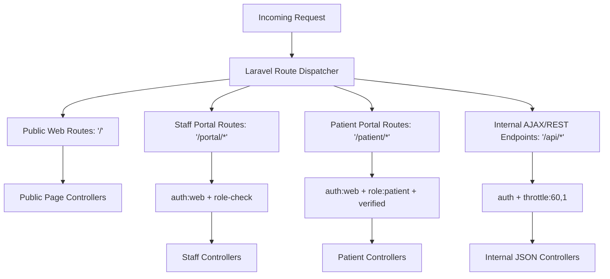

# 09. Application Routing & API Architecture
**Meghna Clinic and Nursing Home — Hospital Management System (HMS)**

---

## 1. Routing Strategy & Domain Grouping
The system adopts a structured, monolithic route architecture separating HTTP requests into distinct prefix groups with specialized middleware stacks:

---

## 2. Public Website Endpoints

| Method | URI | Controller Action | Description |
| :--- | :--- | :--- | :--- |
| `GET` | `/` | `PublicController@home` | Renders clinic landing page |
| `GET` | `/about` | `PublicController@about` | Clinic history, facility, team |
| `GET` | `/departments` | `PublicController@departments` | Gynecology, Orthopedic, Surgery, Emergency |
| `GET` | `/doctors` | `PublicController@doctors` | Doctor profiles and schedules |
| `GET` | `/services` | `PublicController@services` | Clinical and diagnostic services list |
| `GET` | `/contact` | `PublicController@contact` | Location map, contact numbers |
| `GET` | `/appointment-request` | `AppointmentController@requestForm` | Public appointment booking form |
| `POST` | `/appointment-request` | `AppointmentController@submitRequest` | Validates & queues public appointment request |

---

## 3. Staff Portal Endpoints (`/portal/*`)

All staff endpoints require `auth` and specific role permissions.

### A. Authentication & Dashboard
- `GET /portal/login`: Staff login view
- `POST /portal/login`: Authenticates staff credentials (rate-limited)
- `POST /portal/logout`: Destroys session
- `GET /portal/dashboard`: Role-customized dashboard (Bento Grid cards)

### B. Patient & Visit Management
- `GET /portal/patients`: Master patient directory (search by phone/code)
- `GET /portal/patients/create`: New patient registration form
- `POST /portal/patients`: Stores demographic record (`StorePatientRequest`)
- `GET /portal/patients/{id}`: Detailed clinical timeline & past visits
- `POST /portal/visits`: Check-in patient, create OPD or Emergency visit

### C. Inpatient Admission & Bed Management
- `GET /portal/beds`: Visual 10-bed ward map (Bento Grid: Available, Occupied, Cleaning)
- `POST /portal/beds/{id}/status`: Change status (e.g., mark cleaning $\rightarrow$ available)
- `GET /portal/admissions`: Active inpatient roster
- `POST /portal/admissions`: Assign available bed and initialize admission
- `POST /portal/admissions/{id}/transfer-bed`: Move patient to another available bed

### D. Doctor Clinical Consultation
- `GET /portal/consultations/queue`: Attending doctor patient queue
- `GET /portal/consultations/create/{visit_id}`: Consultation authoring workspace
- `POST /portal/consultations`: Stores diagnosis and generates prescription
- `POST /portal/consultations/{id}/order-lab`: Orders diagnostic tests (Internal/External)

### E. Nursing & Bedside Care
- `GET /portal/nursing`: Inpatient observation roster
- `POST /portal/nursing/{admission_id}/vitals`: Records temperature, BP, pulse, SpO2
- `POST /portal/nursing/{admission_id}/mar`: Logs administered medication

### F. Diagnostic Laboratory
- `GET /portal/lab/orders`: Diagnostic test queue
- `POST /portal/lab/orders/{id}/assign-partner`: Assigns order to external partner
- `POST /portal/lab/items/{id}/upload-report`: Uploads completed PDF report
- `POST /portal/lab/reports/{id}/review`: Doctor validates and marks report reviewed

### G. Billing, Payments & Discharge
- `GET /portal/billing/invoices`: Invoices list
- `GET /portal/billing/invoices/{id}`: Itemized bill breakdown
- `POST /portal/billing/invoices/{id}/payments`: Collects payment (partial/full)
- `POST /portal/admissions/{id}/clearance/clinical`: Attending doctor clearance
- `POST /portal/admissions/{id}/clearance/financial`: Cashier financial clearance
- `POST /portal/admissions/{id}/discharge`: Finalizes discharge summary and frees bed

---

## 4. Patient Portal Endpoints (`/patient/*`)

All patient endpoints require `auth`, role `patient`, and `EnsurePatientLinked` middleware.

| Method | URI | Controller Action | Description |
| :--- | :--- | :--- | :--- |
| `GET` | `/patient/login` | `PatientAuthController@loginView` | Patient login screen |
| `POST` | `/patient/login` | `PatientAuthController@authenticate` | Authenticate patient |
| `GET` | `/patient/register` | `PatientAuthController@registerView` | Self-registration screen |
| `POST` | `/patient/register` | `PatientAuthController@register` | Create unlinked patient account |
| `GET` | `/patient/dashboard` | `PatientDashboardController@index` | Patient home screen |
| `GET` | `/patient/appointments` | `PatientDashboardController@appointments` | View submitted appointments & status |
| `GET` | `/patient/prescriptions`| `PatientDashboardController@prescriptions` | View verified prescriptions |
| `GET` | `/patient/prescriptions/{id}/download` | `PatientDashboardController@downloadRx` | Download official Rx PDF |
| `GET` | `/patient/lab-reports` | `PatientDashboardController@labReports` | View verified diagnostic reports |
| `GET` | `/patient/lab-reports/{id}/download` | `PatientDashboardController@downloadLab` | Download secure report PDF |
| `GET` | `/patient/bills` | `PatientDashboardController@bills` | View invoices and payment receipts |

---

## 5. Internal AJAX / REST Endpoints (`/api/*`)
Protected by CSRF and authentication token for dynamic dashboard interactions:
- `GET /api/beds/status`: Returns JSON array of all 10 beds with current status for real-time polling.
- `GET /api/patients/search?q={query}`: Autocomplete search for phone, patient code, or name.
- `GET /api/patients/check-duplicate?phone={phone}`: Fast pre-submit duplicate alert.
- `GET /api/billing/calculate-charges/{admission_id}`: Auto-calculates bed days and bill totals.
