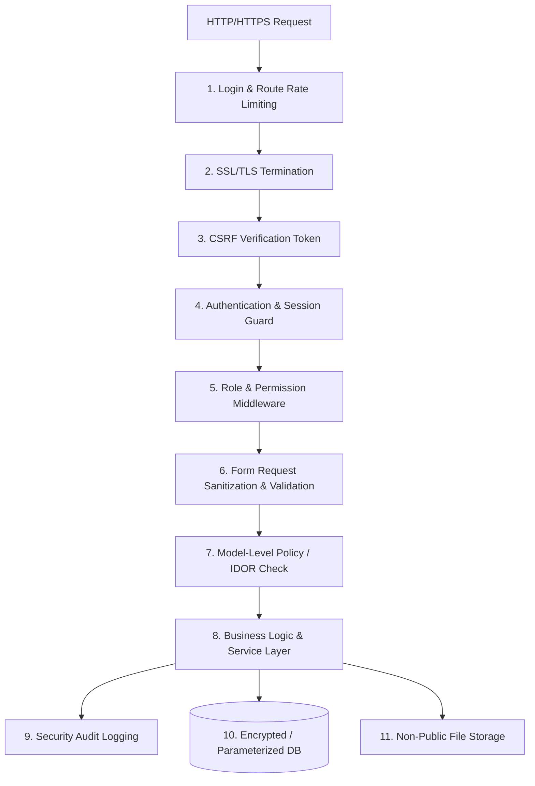
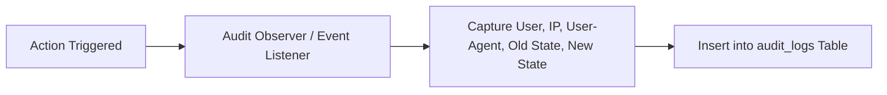

# 10. Security Design, Privacy & Audit Protocol
**Meghna Clinic and Nursing Home — Hospital Management System (HMS)**

---

## 1. Security Architecture Overview
Medical records contain highly confidential personal and health information. The application implements an enterprise defense-in-depth security architecture grounded in the OWASP Top 10 guidelines and strict patient privacy rules.



---

## 2. Core Security & Privacy Controls

### A. Patient Privacy & Account Linking Rule
- **The Vulnerability:** If a user registers online with someone else's phone number or name, they could view sensitive medical history.
- **The Enforcement Rule:** 
  - Patient self-registration creates an **unlinked account**.
  - An unlinked account **cannot** access past clinical visits, prescriptions, lab reports, or admission records.
  - The `EnsurePatientLinked` middleware blocks access to clinical endpoints until a clinic receptionist or administrator formally verifies patient identity and binds the `user_id` to the `patients.id` record.

### B. Authentication & Session Hardening
- **Password Security:** Passwords hashed using `bcrypt` with a minimum cost factor of 12. Minimum password length: 8 characters with mixed case and numerals.
- **Brute Force Protection:** Login endpoints are protected by `throttle:5,1` (maximum 5 failed attempts per minute per IP), triggering a progressive backoff lockout.
- **Session Security:**
  - `session.secure = true` (enforced over HTTPS)
  - `session.http_only = true` (mitigates JavaScript cookie theft)
  - `session.same_site = 'lax'` (prevents cross-site session leaking)
  - Session timeout after 120 minutes of inactivity.

### C. Protection Against OWASP Vulnerabilities

| Threat | Mitigation Mechanism in Laravel 12 |
| :--- | :--- |
| **SQL Injection** | Exclusively uses Eloquent ORM and PDO prepared statements with strict parameter binding. Raw unparameterized queries (`DB::raw("$input")`) are strictly prohibited. |
| **Cross-Site Scripting (XSS)** | All user inputs rendered via Blade `{{ $variable }}` which runs `htmlspecialchars()` with UTF-8 encoding. Medical rich text is scrubbed before storage. |
| **Cross-Site Request Forgery (CSRF)**| Built-in CSRF verification token (`@csrf`) required on all `POST`, `PUT`, `PATCH`, and `DELETE` requests. |
| **Broken Object Level Auth (IDOR)**| Controllers do not fetch records purely by ID parameter without calling `$this->authorize('view', $record)`. Attending doctors can only access their patients; patients can only view their own records. |
| **Sensitive Data Exposure**| `.env` credentials, database credentials, and application keys are excluded from Git. Production stack traces are masked (`APP_DEBUG=false`). |

---

## 3. Secure Medical Document Storage & Delivery

Diagnostic laboratory reports and discharge summaries contain sensitive health data:
1. **Non-Public Storage:** Files are stored in `storage/app/secure_medical_reports/` which is **outside** the public document root (`public/storage` symlink is not used for medical reports).
2. **Strict MIME & Extension Validation:**
   - File uploads must pass explicit server-side inspection via PHP `fileinfo`:
     ```php
     $request->validate([
         'report_file' => 'required|file|mimes:pdf,jpg,png|max:10240', // 10MB max
     ]);
     ```
3. **Authorized Streaming Controller:**
   - Files are never accessed via direct URL.
   - Downloading requires passing through `LabReportController@download`:
     ```php
     public function download(LabReport $report) {
         $this->authorize('view', $report);
         return response()->file(storage_path('app/' . $report->file_path));
     }
     ```

---

## 4. Security Audit Logging Protocol

All high-impact clinical, operational, and financial events are automatically recorded in the `audit_logs` table:



### Monitored Events:
- User login, logout, and failed login attempts.
- Patient demographic updates and clinical record linkings.
- Bed assignments, transfers, and releases.
- Prescription edits or diagnostic report approvals.
- Invoice generation, manual discounts, and payment receipts.
- User permission adjustments and staff deactivations.
