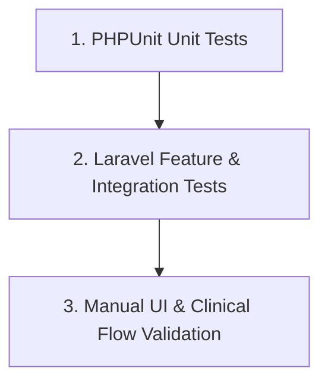

# 11. Quality Assurance & Testing Strategy
**Meghna Clinic and Nursing Home — Hospital Management System (HMS)**

---

## 1. Quality Assurance Philosophy
In a medical clinic management system, software bugs can cause medical errors, double-booked beds, or financial discrepancies. The testing strategy combines automated tests with manual verification checklists before any feature is marked complete.

---

## 2. Testing Pyramid & Test Types

### A. Unit Tests (Isolated Business Logic)
Target fast-executing, standalone utility and calculation logic:
1. **Patient ID Generator:** Validates formatting (`MCNH-YYYY-XXXX`), zero-padding, and collision avoidance.
2. **Visit & Admission Number Generators:** Validates uniqueness and daily sequential numbering.
3. **Billing Calculation Engine:** Tests total invoice calculations:
   - Correct sum of bed charges based on allocated days.
   - Exact sum of diagnostic test items, consultation fees, and procedural charges.
   - Exact remaining due balance calculation after partial payments.
4. **Vitals Normalization:** Checks systolic/diastolic blood pressure parsing and abnormal vital warning thresholds.

### B. Feature & Integration Tests (HTTP & Database)
Executes full request-response lifecycles with MySQL transaction rollbacks:

| Test Case Suite | Target Verification |
| :--- | :--- |
| `PatientRegistrationTest` | Validates duplicate phone detection, master demographic creation, and unique ID generation. |
| `BedConcurrencyTest` | Simulates two simultaneous requests attempting to allocate the same bed. Verifies that pessimistic locking allows exactly one assignment and rejects the second. |
| `AdmissionWorkflowTest` | Tests end-to-end creation of an admission, bed status transition to `occupied`, and creation of a `bed_assignment` record. |
| `DoctorConsultationTest` | Submits diagnoses, prescription lines, and advice. Verifies transactional integrity and prescription rendering. |
| `LaboratoryWorkflowTest` | Validates test order creation, external partner assignment, report PDF upload, and doctor review status changes. |
| `DualDischargeClearanceTest`| Verifies that discharge is blocked if either `clinical_clearance` or `financial_clearance` is false. Verifies bed release upon completed discharge. |
| `RbacAuthorizationTest` | Asserts that nurses cannot alter billing invoices, receptionists cannot author prescriptions, and patients cannot view other patients' records. |

---

## 3. Manual UI & Clinical Verification Checklists

Every user interface feature must be manually validated against this checklist:
- [ ] **Form Validation Feedback:** Required fields, invalid phone formats, or future dates of birth trigger clear, accessible Bootstrap 5 validation error messages.
- [ ] **Bento Grid Dashboard:** 10-bed ward map renders correctly on both desktop (multi-column) and mobile devices (single-column responsive stack).
- [ ] **Typography & Language Display:** Inter renders crisp numeric tables; Hind Siliguri renders proper Bangla text on receipts and public pages without font clipping.
- [ ] **Modal Interactions:** Confirmation dialogs before critical operations (e.g. bed transfer, patient discharge, payment void).
- [ ] **Printable Views:** Prescription print view and invoice cash receipt render cleanly on A4 and POS receipt thermal printers without navigation headers.

---

## 4. Test Data Policy (Zero Real Patient Data)
- **Strict Compliance:** No real patient names, phone numbers, addresses, or actual medical diagnosis histories may ever be used in development, seeding, or automated testing.
- **Factory & Faker Usage:** All test records must be generated using Laravel Factories (`PatientFactory`, `DoctorFactory`, `VisitFactory`) with synthetic, fictional names and mock clinical data.
