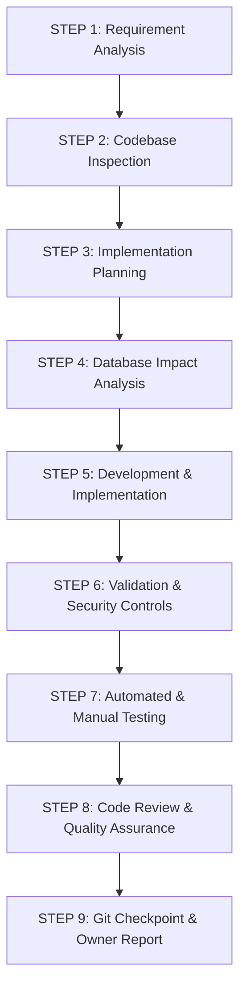

# 12. AI Development Protocol & Small-Step Implementation Strategy
**Meghna Clinic and Nursing Home — Hospital Management System (HMS)**

---

## 1. Governance & Project Hierarchy
- **Project Owner (User):** Holds final architectural, operational, and business authority. Approves design decisions, validates completed phases, and manages Git repository pushes.
- **AI Development Agent (Antigravity):** Responsible for technical implementation strictly following the approved System Design. Prohibited from making independent scope changes, altering database structures without review, or installing unapproved technologies.

---

## 2. The 9-Step Feature Implementation Lifecycle

Every feature, module, or fix must execute through this standardized 9-step pipeline:



### Step Details:
1. **STEP 1: Requirement Analysis:** Understand the requested feature, its clinical or operational purpose, and the relevant actors.
2. **STEP 2: Codebase Inspection:** Inspect existing controllers, models, migrations, views, and routes to avoid duplicate logic or broken contracts.
3. **STEP 3: Implementation Planning:** List files to be created or modified with clear technical rationale.
4. **STEP 4: Database Impact Analysis:** Identify required tables, foreign keys, indexes, unique constraints, and nullable columns before generating migrations.
5. **STEP 5: Development:** Implement only the approved feature using clean, maintainable Laravel 12 best practices (MVC, Service Layer, Form Requests).
6. **STEP 6: Validation & Security:** Enforce Form Request validation rules, CSRF protection, RBAC policies, and input sanitization.
7. **STEP 7: Testing:** Run automated PHPUnit tests and manual verification checklists to confirm functionality and prevent regressions.
8. **STEP 8: Code Review:** Review diffs, verify naming conventions, check edge cases, and inspect audit logging.
9. **STEP 9: Git Checkpoint:** Report all changed files and provide a clean, descriptive commit message. *(Push to GitHub is handled separately by the Project Owner).*

---

## 3. Small-Step Development Policy

To maintain zero defects and ensure every component is fully reviewable, large modules must be decomposed into small, incremental tasks.

### Example: Decomposition of Patient Management Module
```
[Patient Management Module]
├── 1. Patient Registration UI (Blade view with accessible form fields)
├── 2. Patient Registration Backend (Controller, StorePatientRequest, DB insertion)
├── 3. Patient ID Generation (MCNH-YYYY-XXXX sequential unique generator)
├── 4. Duplicate Patient Detection (Fast phone/DOB collision check)
├── 5. Patient Profile View (Demographic card, emergency contact, timeline)
├── 6. Patient Search & Filter (Live search by phone, code, or name)
└── 7. Patient History Timeline (Aggregated past visits, admissions, prescriptions)
```
Each sub-task is completed, verified, and tested before moving to the next.

---

## 4. Strict Technical Boundaries

| Permitted Technologies | Prohibited Technologies |
| :--- | :--- |
| **PHP 8.2+ / Laravel 12** | Node.js backend (Express/Nest), Python (FastAPI/Django) |
| **Bootstrap 5 / Vanilla CSS / Blade** | React.js, Next.js, Vue.js, Angular |
| **MySQL (XAMPP / InnoDB)** | MongoDB, PostgreSQL, SQLite (for production) |
| **Vite Asset Bundler** | Webpack, Mix |
| **Standard Laravel Packages** | Heavy, unnecessary third-party packages |

---

## 5. Git & Version Control Protocol
- **Active Branch:** All development must occur on the dedicated branch:
  ```text
  hospital-management-system
  ```
- **Main Branch Protection:** Never commit or push directly to `main`.
- **Pre-Commit Verification:** Always run `git status` to ensure `.env`, temporary cache, and sensitive credentials remain uncommitted.
- **Push Policy:** The AI Agent will **never** force-push or push code to GitHub without explicit Project Owner confirmation.
